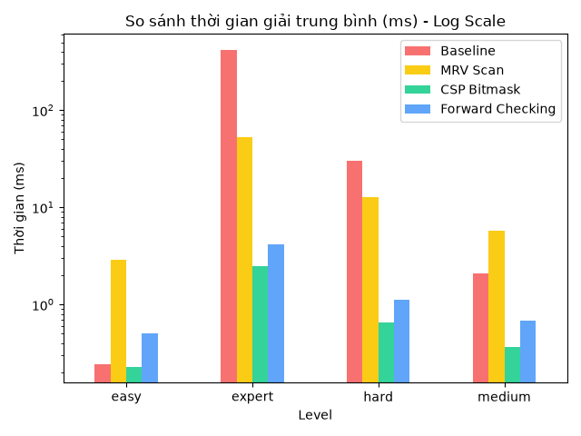
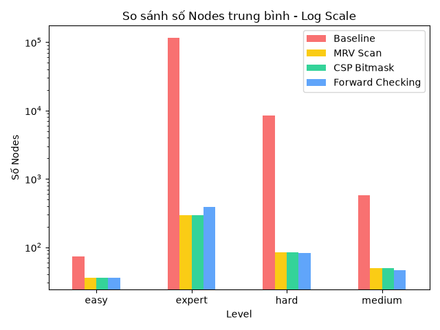

<div align="center">

# 🧩 SUDOKU SOLVER OPTIMIZATION

### Đồ án Nhập môn Tối ưu hóa
### Tối ưu hóa thuật toán giải Sudoku bằng Backtracking kết hợp MRV và biểu diễn Bitmask


**Trường Đại học Văn Lang — Khoa Công nghệ Thông tin**  
**Nhóm thực hiện: Nhóm 09**

</div>

---

## 📖 1. Giới thiệu đề tài

Sudoku là bài toán thỏa mãn ràng buộc (*Constraint Satisfaction Problem – CSP*). Bàn cờ tiêu chuẩn gồm 9 hàng, 9 cột và 9 khối 3×3. Mỗi ô trống cần được điền một chữ số từ 1 đến 9 sao cho không có chữ số nào bị lặp trong cùng hàng, cột hoặc khối 3×3.

Khi số ô trống tăng, việc thử lần lượt các giá trị có thể dẫn đến nhiều nhánh tìm kiếm. Đồ án xây dựng và đánh giá ba phương pháp giải Sudoku nhằm khảo sát ảnh hưởng của chiến lược chọn ô và cách biểu diễn ràng buộc đến thời gian thực thi, số nút tìm kiếm và tỷ lệ giải thành công.

Ngoài chương trình thực nghiệm Python, dự án còn có giao diện web chạy trên trình duyệt, hỗ trợ tạo đề, giải Sudoku, xem gợi ý, so sánh bàn cờ, theo dõi nhật ký và xuất lịch sử.

## 🎯 2. Mục tiêu

- Mô hình hóa Sudoku dưới dạng CSP gồm biến, miền giá trị và các ràng buộc.
- Cài đặt và so sánh ba phương pháp: Baseline Backtracking, MRV Scan và CSP Bitmask + MRV.
- Sinh đề Sudoku có nghiệm duy nhất và chia thành bốn mức độ.
- Đo thời gian giải, số nút tìm kiếm và trạng thái giải thành công.
- Xây dựng giao diện web để người dùng tương tác và quan sát kết quả.

**Câu hỏi nghiên cứu**

1. Bộ giải nào có thời gian giải trung bình thấp nhất ở từng mức độ?
2. MRV giảm số nút tìm kiếm bao nhiêu so với Baseline, và giảm nút có luôn làm giảm thời gian không?
3. Bộ giải nào đạt tỷ lệ giải thành công cao nhất trong giới hạn 5 giây?
4. Biểu diễn bitmask cải thiện hiệu năng như thế nào so với kiểm tra ràng buộc bằng cách quét trực tiếp?

## 🧮 3. Mô hình hóa bài toán

### 3.1. Đầu vào

Một bàn Sudoku 9×9 có một số ô đã cho sẵn (ô gợi ý), các ô còn lại để trống. Bộ dữ liệu thực nghiệm gồm 100 đề có nghiệm duy nhất, chia thành bốn mức Dễ, Trung bình, Khó và Siêu khó (25 đề mỗi mức).

### 3.2. Biến quyết định và miền giá trị

Với mỗi ô ở hàng `r`, cột `c`, biến `x[r,c]` biểu diễn giá trị của ô đó, trong đó `r, c` thuộc {1, 2, …, 9} (tổng cộng 81 biến).

- Ô trống có miền giá trị ban đầu `D[r,c]` = {1, 2, …, 9}; miền này thu hẹp dần khi các ràng buộc được áp dụng.
- Ô đã có số trong đề bài được giữ cố định.

### 3.3. Mô hình CSP

Bài toán được mô tả bởi bộ ba (X, D, C): X là tập 81 biến ô, D là miền giá trị của từng biến, C là tập ràng buộc `AllDifferent` trên mỗi hàng, mỗi cột và mỗi khối 3×3.

### 3.4. Hàm mục tiêu đánh giá

Mọi nghiệm hợp lệ của Sudoku có chất lượng như nhau, nên đối tượng được tối ưu là **chi phí tìm nghiệm**. Với một bộ giải trên tập 100 đề, đồ án đo ba chỉ số:

- Tỷ lệ giải thành công: số đề giải thành công chia cho tổng số đề — chỉ số ưu tiên, cần càng cao càng tốt.
- Thời gian giải trung bình (ms) — cần càng thấp càng tốt, so sánh giữa các bộ giải có tỷ lệ thành công cao.
- Số nút tìm kiếm trung bình — chỉ số phụ dùng để giải thích lượng tìm kiếm.

Thời gian và số nút có đơn vị khác nhau nên được báo cáo riêng; không cộng trực tiếp mili giây với số nút để tạo ra một đại lượng tổng hợp.

### 3.5. Ràng buộc và giới hạn

- **Ràng buộc hàng:** các chữ số trong cùng một hàng không được trùng nhau.
- **Ràng buộc cột:** các chữ số trong cùng một cột không được trùng nhau.
- **Ràng buộc khối:** các chữ số trong cùng một khối 3×3 không được trùng nhau.
- **Ràng buộc dữ liệu gốc:** các ô gợi ý ban đầu không được thay đổi.
- **Giới hạn thời gian:** mã bộ giải Python đặt `TIMEOUT_S = 5.0` giây cho mỗi lần giải. Hết thời gian không có nghĩa là đề chắc chắn vô nghiệm; đó là trường hợp thuật toán chưa hoàn tất trong giới hạn thử nghiệm.

Chi tiết mô hình hóa được trình bày trong [`report/FORMULATION.md`](report/FORMULATION.md).

## ⚙️ 4. Các phương pháp giải

Dự án thực nghiệm cài đặt ba bộ giải trong `src/solvers.py`:

### 4.1. Baseline — Backtracking cơ sở

Duyệt các ô theo thứ tự hàng trước, cột sau. Với mỗi ô trống, thuật toán thử các số từ 1 đến 9, kiểm tra tính hợp lệ rồi tiếp tục đệ quy. Nếu một nhánh không dẫn đến nghiệm, thuật toán quay lui để thử giá trị khác.

**Đặc điểm:** dễ triển khai, là mốc đối chứng để đo lợi ích của các cải tiến, nhưng có thể khảo sát rất nhiều nhánh khi đề khó.

### 4.2. MRV Scan — Backtracking kết hợp MRV

MRV (*Minimum Remaining Values*) chọn ô trống có ít giá trị hợp lệ nhất trước. Việc ưu tiên ô bị ràng buộc chặt giúp phát hiện nhánh không khả thi sớm hơn và thường làm giảm số nút tìm kiếm.

**Đánh đổi:** thuật toán phải quét các ô trống và tính số ứng viên ở mỗi bước, tạo thêm chi phí xử lý. MRV là heuristic chọn biến, không phải kỹ thuật lan truyền ràng buộc.

### 4.3. CSP Bitmask + MRV

Phương pháp này vẫn sử dụng chiến lược chọn ô MRV nhưng lưu trạng thái các hàng, cột và khối bằng **bitmask**. Các phép toán bit xác định nhanh những chữ số còn có thể điền; trạng thái được cập nhật khi gán số và khôi phục khi quay lui.

**Đặc điểm:** trong bộ dữ liệu đi kèm, phương pháp này có thời gian trung bình thấp nhất ở cả bốn mức độ.

### 4.4. So sánh nhanh

| Tiêu chí | Baseline | MRV Scan | CSP Bitmask + MRV |
|---|---|---|---|
| Chiến lược chọn ô | Hàng–cột cố định | Ít ứng viên nhất | Ít ứng viên nhất |
| Kiểm tra ràng buộc | Quét trực tiếp | Quét trực tiếp | Mặt nạ bit |
| Số nút trên đề khó | Cao | Thấp | Thấp |
| Chi phí mỗi bước | Đơn giản | Cao do quét ô | Thấp nhờ bitmask |

> **Lưu ý về số nút:** nút được tăng khi thuật toán thử gán một giá trị hợp lệ theo kiểm tra ban đầu. Quy ước đếm phụ thuộc vị trí tăng bộ đếm trong mã, nên chỉ so sánh số nút giữa các phương pháp trong cùng dự án, không coi là số bước CPU chính xác.

## 🗂️ 5. Cấu trúc dự án

```text
Nhom09_sudoku-solver-optimization-main/
├── README.md
├── requirements.txt
├── run_experiments.py
├── analyze.py
├── data/
│   └── README.md
├── report/
│   └── FORMULATION.md
├── src/
│   ├── solvers.py
│   ├── generator.py
│   └── web_demo/
│       ├── index.html
│       ├── style.css
│       ├── logic.js
│       ├── ui.js
│       └── images/
├── results/
│   └── benchmark_results.csv
└── figures/
    ├── fig_runtime_comparison.png
    └── fig_nodes_comparison.png
```

| Tệp/thư mục | Chức năng |
|---|---|
| `src/solvers.py` | Cài đặt ba bộ giải và trả về trạng thái, thời gian, số nút |
| `src/generator.py` | Sinh bàn Sudoku và kiểm tra để giữ đề có duy nhất một nghiệm |
| `run_experiments.py` | Chạy benchmark và ghi kết quả ra CSV |
| `analyze.py` | Đọc CSV, tính trung bình và tạo biểu đồ |
| `results/benchmark_results.csv` | Dữ liệu benchmark 100 đề được cung cấp kèm dự án |
| `figures/` | Biểu đồ thời gian và số nút tìm kiếm |
| `report/FORMULATION.md` | Mô hình hóa bài toán |
| `src/web_demo/` | Giao diện Sudoku chạy trực tiếp trên trình duyệt |

## 📊 6. Kết quả thực nghiệm

Dữ liệu trong `results/benchmark_results.csv` gồm **100 đề**, với 25 đề ở mỗi mức Dễ, Trung bình, Khó và Siêu khó. Các số liệu dưới đây là trung bình được tính từ CSV đi kèm dự án; thời gian thực tế có thể thay đổi theo máy và môi trường chạy.

### 6.1. Thời gian giải trung bình

| Mức độ | Baseline (ms) | MRV Scan (ms) | CSP Bitmask + MRV (ms) |
|---|---:|---:|---:|
| Dễ | 0.231 | 2.819 | **0.218** |
| Trung bình | 1.959 | 5.424 | **0.331** |
| Khó | 28.728 | 12.152 | **0.621** |
| Siêu khó | 486.408 | 65.394 | **2.987** |

### 6.2. Số nút tìm kiếm trung bình

| Mức độ | Baseline | MRV Scan | CSP Bitmask + MRV |
|---|---:|---:|---:|
| Dễ | 72.5 | **36.0** | **36.0** |
| Trung bình | 581.8 | **49.6** | **49.6** |
| Khó | 8,542.9 | **84.8** | **84.8** |
| Siêu khó | 100,433.9 | **291.9** | **291.9** |

### 6.3. Tỷ lệ giải thành công

| Mức độ | Baseline | MRV Scan | CSP Bitmask + MRV |
|---|---:|---:|---:|
| Dễ | 25/25 | 25/25 | 25/25 |
| Trung bình | 25/25 | 25/25 | 25/25 |
| Khó | 25/25 | 25/25 | 25/25 |
| Siêu khó | 24/25 | 25/25 | 25/25 |
| **Tổng** | **99/100** | **100/100** | **100/100** |

### 6.4. Nhận xét

- **CSP Bitmask + MRV** có thời gian trung bình thấp nhất ở cả bốn mức độ trong bộ dữ liệu này.
- **MRV Scan** giảm đáng kể số nút so với Baseline, đặc biệt ở mức Khó và Siêu khó. Tuy nhiên, chi phí quét tìm ô có ít ứng viên khiến MRV Scan chậm hơn Baseline ở mức Dễ và Trung bình; từ mức Khó trở đi, lợi ích giảm nhánh mới vượt chi phí này.
- MRV Scan và CSP có số nút trung bình giống nhau trong dữ liệu, nhưng CSP nhanh hơn nhờ cách biểu diễn và kiểm tra ràng buộc bằng bitmask. Như vậy, giảm số nút không tự động đồng nghĩa với giảm thời gian chạy.
- Baseline giải thành công 99/100 đề; một đề Siêu khó chạm giới hạn thời gian khoảng 5 giây.
- Kết quả chỉ phản ánh bộ 100 đề được cung cấp, chưa đủ để khẳng định hiệu năng tương tự với mọi bộ Sudoku.

## 📈 7. Biểu đồ kết quả

Các biểu đồ được tạo bởi `analyze.py` từ `results/benchmark_results.csv`. Trục thời gian và số nút sử dụng thang logarit để thể hiện sự chênh lệch giữa các thuật toán.

### So sánh thời gian giải



### So sánh số nút tìm kiếm



## 🖥️ 8. Giao diện web

Giao diện nằm trong `src/web_demo/` và chạy phía trình duyệt bằng HTML, CSS và JavaScript. Các chức năng chính gồm:

- Hiển thị bàn Sudoku 9×9 và hỗ trợ nhập đề.
- Tạo đề theo các mức Dễ, Trung bình, Khó và Siêu khó.
- Giải Sudoku nhanh hoặc theo từng bước.
- Hiển thị gợi ý, số lỗi, thời gian và số nút.
- So sánh hai bàn cờ, xem nhật ký và biểu đồ.
- Lưu lịch sử bằng `localStorage`, xóa lịch sử và xuất CSV.

Giao diện web chạy thuật toán JavaScript riêng ở phía trình duyệt; vì vậy, số liệu của giao diện không nhất thiết trùng khớp hoàn toàn với benchmark Python.

## 🚀 9. Cài đặt và chạy chương trình

### 9.1. Yêu cầu

- Python 3.8 trở lên.
- Các thư viện được liệt kê trong `requirements.txt`: `pandas`, `matplotlib`, `numpy`.
- Trình duyệt web hiện đại để chạy giao diện.
- Kết nối Internet nếu giao diện cần tải thư viện từ CDN.

### 9.2. Mở terminal tại thư mục gốc dự án

Cài đặt thư viện:

```bash
pip install -r requirements.txt
```

### 9.3. Chạy thực nghiệm Python

```bash
python run_experiments.py
```

Lệnh này sinh đề theo bốn mức độ, chạy ba bộ giải và ghi kết quả mới vào:

```text
results/benchmark_results.csv
```

Mỗi mức có 25 đề, tổng cộng 100 đề. Quá trình chạy có thể mất thời gian tùy máy, đặc biệt với Baseline ở mức Siêu khó. Nếu chạy lại, đề được sinh mới nên số liệu sẽ khác bảng ở Mục 6; cần cập nhật bảng và nhận xét tương ứng.

### 9.4. Tạo biểu đồ

Sau khi có file CSV, chạy:

```bash
python analyze.py
```

Hai biểu đồ được xuất vào thư mục `figures/`:

- `fig_runtime_comparison.png`
- `fig_nodes_comparison.png`

### 9.5. Mở giao diện web

Mở trực tiếp tệp sau bằng trình duyệt:

```text
src/web_demo/index.html
```

Có thể nhấp đúp vào tệp `index.html` hoặc mở trình duyệt rồi kéo tệp vào cửa sổ trình duyệt. Một số thư viện giao diện được tải từ CDN nên cần Internet để hiển thị đầy đủ các thành phần phụ thuộc.

## ⚠️ 10. Giới hạn và hướng phát triển

### Giới hạn hiện tại

- Bộ benchmark gồm 100 đề, chỉ phù hợp để minh họa và so sánh ban đầu.
- Thời gian chạy phụ thuộc phần cứng, phiên bản Python và tải hệ thống.
- Việc sinh đề đặt số ô gợi ý mục tiêu, nhưng yêu cầu nghiệm duy nhất có thể khiến số ô gợi ý thực tế không luôn đạt đúng mục tiêu.
- Hai chỉ số thời gian và số nút có đơn vị khác nhau nên được phân tích riêng.
- Bộ giải có giới hạn thời gian 5 giây cho mỗi lần giải.
- Forward Checking **chưa được cài đặt** trong `src/solvers.py` nên chưa nằm trong phạm vi đánh giá.

### Hướng phát triển

- Tăng số lượng đề, chạy lặp benchmark và báo cáo trung vị, độ lệch chuẩn.
- Kiểm tra dữ liệu đầu vào và phát hiện đề mâu thuẫn.
- Bổ sung, đánh giá rõ ràng Forward Checking hoặc các heuristic khác như Least Constraining Value (LCV).
- Đo riêng chi phí chọn ô, kiểm tra ràng buộc và cập nhật trạng thái.
- Bổ sung kiểm thử tự động cho đề hợp lệ, đề vô nghiệm và dữ liệu nhập sai.

## 👥 11. Thành viên thực hiện

**Nhóm 09 — Khoa Công nghệ Thông tin, Trường Đại học Văn Lang**

| Họ và tên | Mã số sinh viên |
|---|---|
| Nguyễn Hà Tiến Đạt | 2474802010077 |
| Nguyễn Bảo Lâm | 2474802010209 |
| Lâm Hữu Lộc | 2474802010221 |

## 📚 12. Tài liệu tham khảo

- Russell, S. và Norvig, P. — *Artificial Intelligence: A Modern Approach*, nội dung về Constraint Satisfaction Problems.
- [Python Documentation](https://docs.python.org/3/)
- [Pandas Documentation](https://pandas.pydata.org/docs/)
- [Matplotlib Documentation](https://matplotlib.org/stable/)
- [`report/FORMULATION.md`](report/FORMULATION.md) — mô hình hóa bài toán của dự án.
